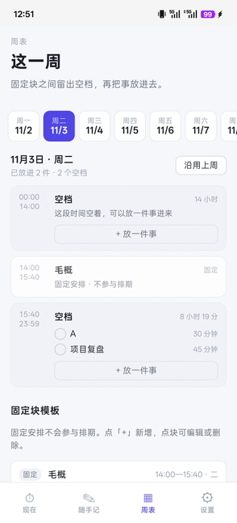
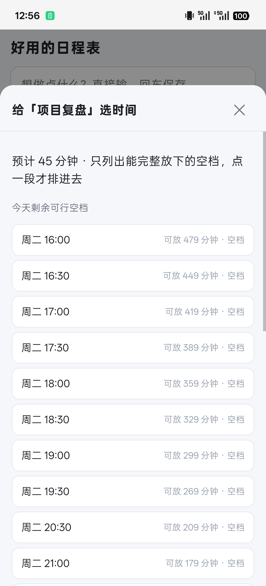
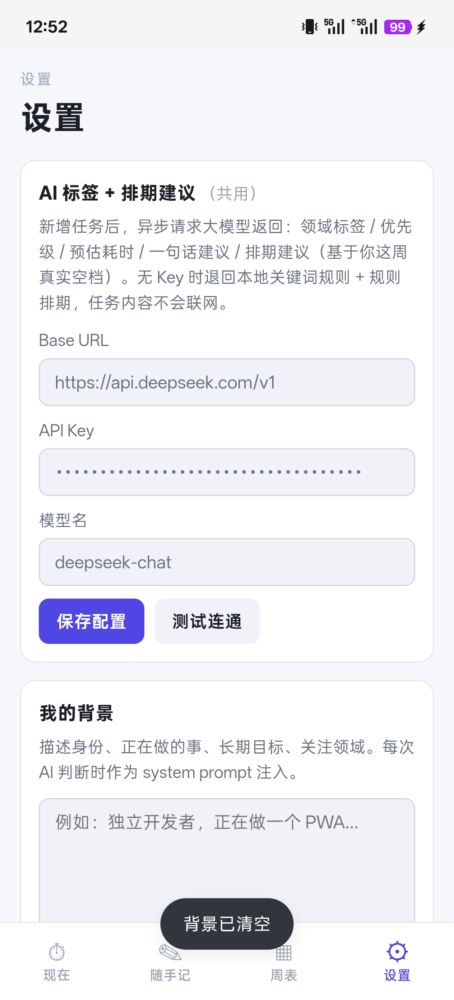

# 好用的日程表

把「随手记」和「这周怎么排」合成一个手机端小工具 —— 想到就记，AI 帮你判断什么时候做。

**线上直接打开：<https://cocy-lab.github.io/haoyong-schedule/>**

| 现在页 | 随手记 | 周表 | 排期 |
| :--: | :--: | :--: | :--: |
|  |  |  |  |
| 现在页——只看此刻该做的那一块 | 随手记——一句话记下，AI 给标签、优先级、时长和建议时段 | 周表——固定块留出空档，再把待办放进去 | 排期时自己选时段——只列出能完整放下的空档 |

## 为什么做这个

每天冒出来的事很容易丢：想到的时候没记，过一会儿就忘了。就算记下来，周表上排得再整齐，人也常常卡在「现在这个点到底该动哪件」。

所以把两件事塞进同一个东西：随手记负责接住想法，周表负责安排位置，而「现在」页只回答一个问题 —— 这一段时间，做哪一件。

## 能做什么

- **随手记**：一个输入框，回车即存，不打断思路。
- **AI 判断（可选）**：自动给标签、优先级、预计用时，并建议放到哪个空档。配置了 API Key 才启用；没有 Key 或调用失败时，降级为本地关键词规则，功能不中断。
- **周表**：固定块（会议、午饭这类挪不动的事）和可安排块分开放，固定块之间自动留出空档。
- **空档计算**：候选空档会留 15 分钟缓冲，并且必须能完整放下任务的预计用时，不会把任务切成两半。
- **现在页**：显示当前这个块是什么、走到哪了、下一段空档在哪，以及"今天剩下的"时间线。
- **错过的进待补，手动顺延**：过了时间没做的任务不会消失，也不会被自动删掉。
- **排期由你自己决定**：打开排期抽屉会列出今天剩余 / 明天的可行空档，点哪一段才排进去；不点就保持未排期。

## 装到手机

安卓：用浏览器打开上面的链接 → 菜单里选「添加到主屏幕」。装好后是一个墨绿色图标，点开全屏运行，没有地址栏。

iOS：Safari 打开 → 分享 → 「添加到主屏幕」，同理。

第一次使用建议先在「设置」里填一点自己的背景（比如你的作息、常做的事），AI 的建议会更贴一些；不填也能用。

## 技术实现

- 零构建、纯静态：没有打包器、没有 CDN、没有第三方依赖，浏览器直接跑源码。
- 数据放 `localStorage`，按 `ssj.v1.*` 分区存放，刷新和离线都不丢。
- Service Worker：静态资源 Cache First，HTML 走 Network First，断网也能打开。
- AI 走 OpenAI 兼容的 Chat Completions 接口（默认 DeepSeek），Key 只存在本机 localStorage，请求直接从浏览器发出。
- 图标是纯色 `#1B5E4F`，manifest 里同时声明了 `any` 与 `maskable`。

### AI 配置（可选）

不配也能用；想让它按你的作息和目标判断，就在设置页填 Base URL、API Key 和模型名（默认 DeepSeek）。

<p align="center">
  
  <br>
  <sub>设置页：AI 配置（Base URL / API Key / 模型名）</sub>
</p>

### 目录结构

```
index.html              页面骨架
css/app.css             样式（含深色主题）
js/storage.js           localStorage 读写、默认值与向后兼容
js/schedule.js          时间模型：固定块合成、空档计算、排期
js/ai.js                可选的 AI 判断与排期建议（含本地规则兜底）
js/app.js               页面渲染与交互（tab、周表、抽屉）
sw.js                   Service Worker
manifest.webmanifest    PWA 清单
docs/screenshots/       README 用截图
```

## 已知限制

- 数据只存在当前浏览器里。换设备或清缓存前，请先在设置页导出 JSON。
- 没有账号体系，不做多端同步 —— 这是故意的，个人工具不需要登录。
- AI 需要自备 Key；不配也能用，只是判断依据变成关键词规则。
- 排期建议只覆盖今天和明天两天，不往后推更远。

## 关于

这是一个个人自用工具，顺手开源出来。用着有问题、或者想要什么改动，欢迎提 issue。
